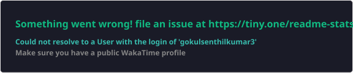

<!-- markdownlint-disable MD033 MD036 MD041 MD022 MD040 MD045 MD060 -->

 

  
  &nbsp;
  
  &nbsp;
  

I am an <strong>SDET</strong> who builds things that <em>actually work under pressure</em> — writing AI-native test frameworks by day and shipping full-stack products by night. 
My philosophy: <em>software should not just work — it must be <strong>unshakeable</strong>.</em>

  
  &nbsp;
  
  &nbsp;
  
  &nbsp;
  
  &nbsp;
  

---

## Focus Areas

| Domain | What I Do |
|--------|-----------|
| Testing and Quality | AI-native test automation · Shift-Left · Chaos Engineering |
| Performance | High-throughput load and stress testing with k6 · Observability |
| Security | Designed MathShield-CDN — next-gen human verification beyond CAPTCHA |
| AI and Automation | [ProbeAI](https://github.com/gokulsenthilkumar3/ProbeAI) · [VeriLexAI](https://github.com/gokulsenthilkumar3/VeriLexAI) — LLM eval and compliance intelligence |
| Research | Programming language design (Lang) · Next-gen OS from scratch |
| Civic Tech | [FindThemNow](https://github.com/gokulsenthilkumar3/FindThemNow) — real-world missing-persons alert platform |

---

## Technology Stack

### Languages

### Frontend

### Backend and Databases

### Testing and QA

### DevOps and Cloud

---

## Featured Projects

<table>
<tr>
<td width="50%" valign="top">

### [NexFlow](https://github.com/gokulsenthilkumar3/NexFlow)
**Project management and helpdesk platform**

Feature-rich platform inspired by Azure DevOps and Zoho Desk — ticketing, sprint boards, issue tracking, and team collaboration tools built with CI from day one.

</td>
<td width="50%" valign="top">

### [Velo](https://github.com/gokulsenthilkumar3/Velo)
**EV scooter-sharing platform**

Full platform for EV scooter sharing in Tier-2 cities — Android rider app, web ops/admin portals, TypeScript stack, and AWS deployment.

</td>
</tr>
<tr>
<td width="50%" valign="top">

### [Evergreen](https://github.com/gokulsenthilkumar3/Evergreen)
**Long-term scalability web application**

TypeScript web app built around maintainability-first design — smooth user workflows, modular architecture, and a UI engineered to stay relevant as the product scales.

</td>
<td width="50%" valign="top">

### [VeriLexAI](https://github.com/gokulsenthilkumar3/VeriLexAI)
**AI workspace for legal and compliance**

AI-powered workspace for Indian audit, tax, document intelligence, and legal-compliance research — LLM capabilities applied to traditionally manual compliance workflows.

</td>
</tr>
<tr>
<td width="50%" valign="top">

### [Ultimate](https://github.com/gokulsenthilkumar3/Ultimate)
**Personal operations dashboard**

Minimal, high-density personal ops app — fitness tracking, parametric 3D humanoid twin, finance, habits, tasks, and wellness unified into a single dashboard.

</td>
<td width="50%" valign="top">

### [ForgeOS](https://github.com/gokulsenthilkumar3/ForgeOS)
**Unified monorepo platform**

A monorepo unifying all products into shared workspaces — shared identity, roles, secrets, audit, search, notifications, and deployment tooling. Supports multi-tenant SaaS and self-hosted Docker/Kubernetes.

</td>
</tr>
<tr>
<td width="50%" valign="top">

### [Portfolio](https://github.com/gokulsenthilkumar3/Portfolio)
**Personal developer showcase**

Built with Next.js 14, TypeScript, and Tailwind CSS — server-side rendering, optimized performance, and pixel-perfect responsive design. Deployed on Vercel with CI/CD.

</td>
<td width="50%" valign="top">

### [FindThemNow](https://github.com/gokulsenthilkumar3/FindThemNow)
**Real-time missing-persons alert platform**

Fast, zero-dependency web app for real-time search and contact discovery — built for instant feedback, minimal UI friction, and civic impact. Hosted on GitHub Pages.

</td>
</tr>
</table>

---

## Currently Building

- **[Lang](https://github.com/gokulsenthilkumar3/Lang)** — A new programming language: Rust-level safety · Go-level readability · gradual formal verification · unified compiler-runtime-package toolchain
- **[OS](https://github.com/gokulsenthilkumar3/OS)** — Next-gen OS research: capability-based microkernel · AI-native scheduling · atomic live updates · formal verification (Phase 0)
- **[AgroOS](https://github.com/gokulsenthilkumar3/AgroOS)** — India-focused agriculture platform: HydroGrow (IoT hydroponics) · FarmFresh Eggs (poultry ops) · Agri-Coop · ColdChain Hub

---

## GitHub Stats

<picture>
  <source media="(prefers-color-scheme: dark)" srcset="./assets/stats/github-stats-dark.svg" />
  <source media="(prefers-color-scheme: light)" srcset="./assets/stats/github-stats-light.svg" />
  
</picture>
&nbsp;&nbsp;
<picture>
  <source media="(prefers-color-scheme: dark)" srcset="./assets/stats/top-langs-dark.svg" />
  <source media="(prefers-color-scheme: light)" srcset="./assets/stats/top-langs-light.svg" />
  
</picture>

 

---

## Contribution Graph

<picture>
  <source media="(prefers-color-scheme: dark)" srcset="https://raw.githubusercontent.com/gokulsenthilkumar3/gokulsenthilkumar3/output/github-contribution-grid-snake-dark.svg" />
  <source media="(prefers-color-scheme: light)" srcset="https://raw.githubusercontent.com/gokulsenthilkumar3/gokulsenthilkumar3/output/github-contribution-grid-snake.svg" />
  
</picture>

---

## WakaTime Coding Activity

<picture>
  <source media="(prefers-color-scheme: dark)" srcset="./assets/stats/wakatime-dark.svg" />
  <source media="(prefers-color-scheme: light)" srcset="./assets/stats/wakatime-light.svg" />
  
</picture>

---

> *"True engineering is measured by how a system behaves when things go wrong."*

 

**Open to opportunities and collaborations**

 

